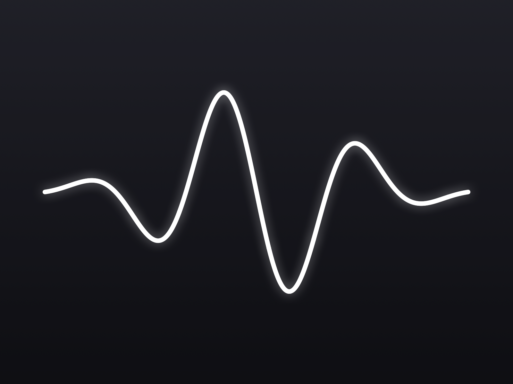

# Oscilinea

A focused macOS audio visualizer plug-in that renders the living shape of a sound — and makes that display easy to record or capture in streaming and video tools.

**Downloads live in [Releases](../../releases).**

Load Oscilinea on a track and it draws one steady, period-locked contour that morphs with oscillator shape, filtering, PWM, distortion, and dynamics. The audio passes through untouched — no processing, no latency, no tonal change. The display is the product.

## Highlights

- **One focused display.** Period-seeking mono trace with cycle averaging and graceful fallback for noisy or polyphonic sources.
- **Capture-first workflow.** Built-in `.mov` recording with the plug-in's audio (H.264, or ProRes 4444 with alpha for transparent backgrounds), a dedicated source window for Window Capture in streaming tools, and per-instance [Syphon](https://syphon.github.io/) output for live visual apps — Syphon support is built in, nothing extra to install.
- **Quiet, system-style controls.** The panel stays hidden until you reveal it from a subtle bottom handle; the trace stands alone.
- **Your look, by default.** Save the current appearance as the default for new instances without touching existing sessions.
- **Three formats.** Audio Unit for Logic Pro and GarageBand, VST3, and a standalone app — pick any or all in the installer.

## Requirements

- macOS 11 (Big Sur) or later
- Apple silicon and Intel (universal binary)

## Install

Download the `.pkg` from [Releases](../../releases) and double-click it. The installer is signed and notarized by Apple — no security warnings. Choose which formats to install (AU, VST3, Standalone app); updates install the same way, right over the previous version, and existing DAW sessions keep working.

In your DAW, Oscilinea appears under the **Haza** manufacturer folder.

## Status

Oscilinea is in beta. If something misbehaves, [open an issue](../../issues) — bug reports and ideas are very welcome.
